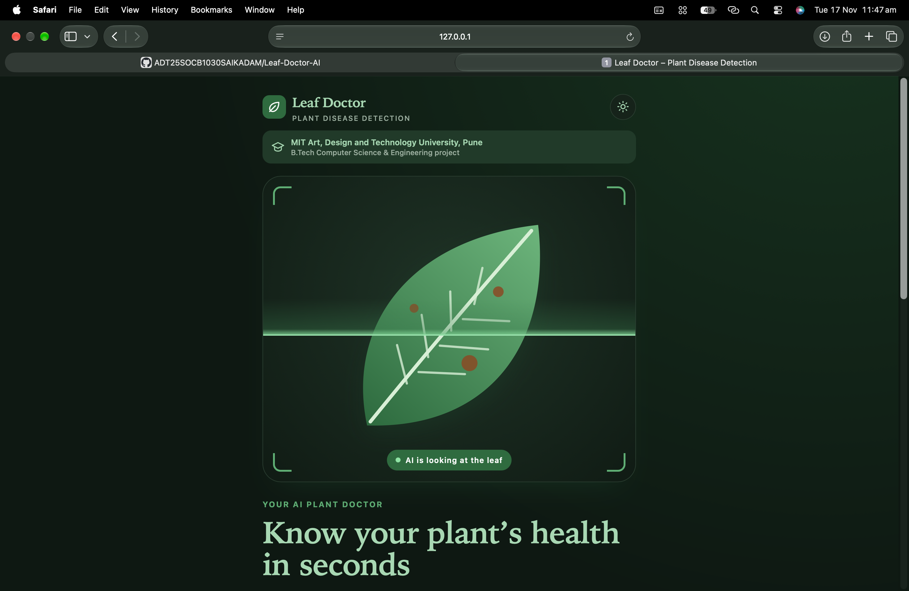
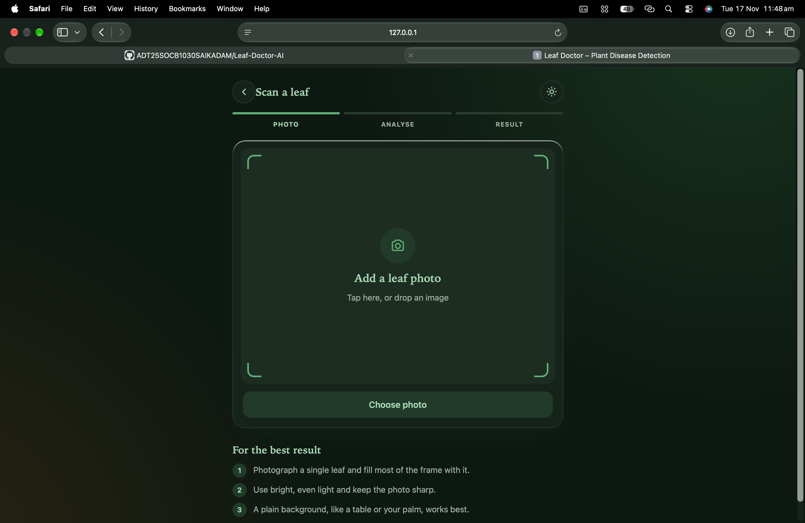
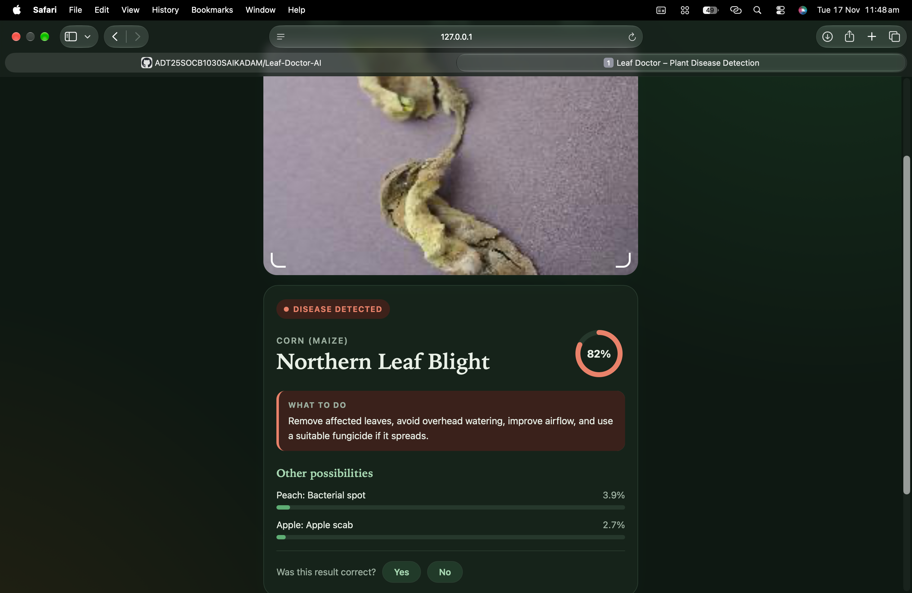

# 🌿 Leaf Doctor AI

### AI-Based Plant Disease Detection System

An AI-powered platform designed to help farmers detect plant diseases using leaf images through Deep Learning and Convolutional Neural Networks (CNN).

## 📌 About the Project

Leaf Doctor AI is an intelligent plant disease detection system that analyzes uploaded leaf images and identifies potential plant diseases.

The system aims to help farmers identify diseases at an early stage, reduce crop losses and promote sustainable agriculture.

## 🎯 Objectives

- Detect plant diseases using leaf images.
- Identify healthy and infected plants.
- Provide information about detected diseases.
- Suggest recommendations for disease management.
- Support sustainable farming practices.

## ✨ Key Features

- AI-based plant disease detection.
- Leaf image upload and analysis.
- Disease identification.
- Disease information and recommendations.
- Hardware and sensor integration.
- Irrigation-related functionality.
- User feedback system.

## 🛠️ Technologies Used

- Python
- TensorFlow / Keras
- Convolutional Neural Networks (CNN)
- Frontend technologies (as implemented)
- SQLite
- Git and GitHub

## 📂 Project Structure

```text
Leaf-Doctor-AI/
├── frontend/
├── hardware/
├── tests/
├── main.py
├── model.keras
├── class_names.json
├── sensor.py
├── irrigation.py
├── feedback.py
├── guard.py
├── requirements.txt
├── MODEL_CARD.md
├── Dockerfile
└── README.md
```

## 📸 Project Screenshots

## 📸 Website Screenshots

### Homepage


### Dashboard


### Disease Detection


## 🌍 Sustainable Development Goals

**SDG 2 – Zero Hunger**

The project contributes to sustainable agriculture by helping farmers identify plant diseases early and reduce crop losses.

## 🚀 Future Scope

- Improve disease detection performance.
- Support more plant species.
- Add regional language support.
- Integrate IoT-based monitoring.
- Deploy the platform for farmers.

## 👨‍💻 Project Information

**Project:** Leaf Doctor AI  
**Domain:** Artificial Intelligence and Machine Learning  
**Application:** Smart Agriculture  
**Primary SDG:** Zero Hunger

---

*An academic project focused on using Artificial Intelligence to support sustainable agriculture.*
